# 🌐 Awesome Network Management System (NMS) & IoT Framework 🚀

  
  
  

> 🎯 A curated directory of top **Network Management Systems (NMS)** and **IoT Framework** platforms — featuring enterprise SaaS/hosted observability solutions and production-ready open-source alternatives for infrastructure monitoring, device telemetry, SNMP polling, DCIM/IPAM, and IoT device orchestration. 📡⚡
>
> 🌟 **Star this repo if you find it useful!** 🌟

---

## 📋 Table of Contents

- [📈 Sector Overview & Market Dynamics](#-sector-overview--market-dynamics)
- [🟦 SaaS / Hosted Platforms](#-saas--hosted-platforms)
- [🟩 Open-Source Software](#-open-source-software)
  - [ThingsBoard 📱](#thingsboard)
  - [NetBox 🗺️](#netbox)
  - [EMQX ⚡](#emqx)
  - [Zabbix 🛡️](#zabbix)
  - [LibreNMS 🔍](#librenms)
  - [Checkmk Raw ⚙️](#checkmk-raw)
  - [Icinga 2 🎯](#icinga-2)
  - [OpenRemote 🏙️](#openremote)
  - [Nagios Core 🚦](#nagios-core)
  - [Cacti 📊](#cacti)
  - [OpenNMS 🌐](#opennms)
  - [NetXMS 💻](#netxms)
  - [Eclipse Kapua ☁️](#eclipse-kapua)
  - [FIWARE Orion 🏛️](#fiware-orion)
- [📊 Comparison at a Glance](#-comparison-at-a-glance)
- [⭐ Star History](#-star-history)
- [💖 Support & Sponsorship](#-support--sponsorship)
- [🤝 Contributing](#-contributing)
- [📄 License](#-license)

---

## 📈 Sector Overview & Market Dynamics

The global Network Management System (NMS) and IoT software market is currently valued between **$10 billion and $12.3 billion** and is projected to surpass **$25 billion by 2034**, expanding at a steady Compound Annual Growth Rate (CAGR) of **~9.5%–10.2%**. 🚀

The sector displays a **moderately consolidated structure at the top enterprise tier**—dominated by large publicly traded and institutional observability/networking titans (such as Datadog, Cisco, and SolarWinds)—while remaining **highly fragmented across mid-market, edge, and specialized verticals**. In particular, specialized open-source platforms and agile private vendors capture significant market share across on-premises enterprise networks, telecommunications, and industrial IoT deployments where data sovereignty, SNMP extensibility, and custom telemetry are paramount. 🏢🔌

---

## 🟦 SaaS / Hosted Platforms

Commercial, cloud-hosted Network Management, Infrastructure Observability, and IoT telemetry suites. Sorted by company size (valuation / market capitalization / revenue) in descending order: 💼📉

| Platform | Company Size (Valuation / Revenue) | Starting Tier Pricing | Free Tier / Trial Limit | Key Focus & Strengths |
| :--- | :--- | :--- | :--- | :--- |
| **[Datadog Network Monitoring](https://www.datadoghq.com/product/network-monitoring/)** 🐶 | **~$65B Market Cap** (~$4.3B TTM Revenue) | **$5.00/host/month** (Cloud Network Monitoring) or **$7.00/device/month** (Network Device Monitoring; billed annually) | **14-day free trial** with full access to all features (no credit card required); permanent free tier is limited to basic infrastructure (max 5 hosts, 1-day metric retention, no deep network flow analysis) | Cloud-native network observability, SNMP hardware metrics, NetFlow/IPFIX analysis, and end-to-end tracing correlated with full-stack logs and APM. ☁️ |
| **[ManageEngine OpManager](https://www.manageengine.com/network-monitoring/)** 🏢 | **~$12B+ Zoho Valuation** (~$580M+ Division Revenue) | **$95/year** (Standard Edition for up to 10 devices) or **$245/year** (Professional Edition for up to 10 devices) | **Permanent Free Edition** limited to a maximum of **3 network devices** with basic performance monitors and email alerts; 30-day fully functional unlimited free trial available | Integrated network, server, switch, and router management with preconfigured SNMP performance monitors and automated configuration backups. 🔄 |
| **[SolarWinds NPM](https://www.solarwinds.com/network-performance-monitor)** ☀️ | **~$3.2B Valuation** (~$797M ARR, Taken Private by Turn/River) | **$2,829** (perpetual base license) or **$8.00/node/month** (subscription model) | **30-day free trial** with 100% full functionality across all features, intelligent discovery, NetPath hop-by-hop analysis, and custom alerting (no credit card required) | Enterprise gold standard for multi-vendor network health, fault detection, hop-by-hop NetPath packet inspection, and capacity planning. 🔍 |
| **[LogicMonitor](https://www.logicmonitor.com/)** 🧠 | **~$2.4B Valuation** (~$400M+ ARR) | **$16.00/Hybrid Unit/month** (LM Essentials tier, minimum commitment applies) | **14-day free trial** with full feature set and access to Edwin AI sandbox; limits based on standard Hybrid Unit (HU) quotas (~2M metric collections/day/device) | Agentless SaaS hybrid-cloud infrastructure monitoring with automated collector discovery and predictive AIOps root-cause analytics. 🤖 |
| **[PRTG Network Monitor](https://www.paessler.com/prtg)** 🚦 | **~$50M–$100M Revenue** (Turn/River Capital Backed) | **$200/month** (PRTG 500 tier for up to 500 sensors, billed annually) | **Permanent Freeware Edition** with up to **100 sensors** (~10 devices monitored 24/7 at no cost); also includes an initial 30-day unrestricted trial of all enterprise features | Sensor-based monitoring for on-premise and distributed networks; turnkey Windows deployment covering ping, SNMP, NetFlow, and WMI out of the box. 🪟 |

---

## 🟩 Open-Source Software

Self-hosted, community-governed Network Management Systems, Infrastructure Observability suites, and IoT Orchestration Frameworks. Sorted by GitHub star count in descending order: 🌟🛠️

### ThingsBoard

* **Repository:** [thingsboard/thingsboard](https://github.com/thingsboard/thingsboard) 📦
* **Stack:** Java / PostgreSQL / Cassandra / Hybrid | **License:** Apache-2.0 📜
* **Overview:** ThingsBoard is the most popular open-source IoT platform for device management, data collection, processing, and real-time visualization. It supports industry-standard protocols including MQTT, CoAP, and HTTP, scaling horizontally to millions of devices with fault-tolerant clustering, customizable RPC remote control, and a drag-and-drop rule engine for event workflows. 📱⚡
* **Best for:** Scalable IoT device orchestration, telemetry ingestion, digital twin tracking, and smart telemetry dashboards.

### NetBox

* **Repository:** [netbox-community/netbox](https://github.com/netbox-community/netbox) 📦
* **Stack:** Python / Django / PostgreSQL / Redis | **License:** Apache-2.0 📜
* **Overview:** NetBox is the industry-standard Network Source of Truth (NSoT) and Infrastructure Resource Management (DCIM/IPAM) application. It models physical and virtual networks, IP address allocations, rack elevations, cable paths, and device configurations with native REST and GraphQL APIs designed to power modern network automation workflows. 🗺️🔌
* **Best for:** IP address management (IPAM), datacenter infrastructure modeling (DCIM), and network automation source-of-truth architectures.

### EMQX

* **Repository:** [emqx/emqx](https://github.com/emqx/emqx) 📦
* **Stack:** Erlang / Elixir / C | **License:** Apache-2.0 📜
* **Overview:** EMQX is an ultra-scalable, open-source distributed MQTT broker designed for IoT, IIoT, and connected vehicles. Powered by the Erlang/OTP runtime, it handles up to 100M+ concurrent MQTT connections and throughput of 1M+ messages per second per cluster with sub-millisecond latency and a built-in SQL-based data integration rule engine. 🏎️💨
* **Best for:** High-throughput, distributed IoT messaging, real-time vehicle-to-cloud telemetry, and industrial edge-to-cloud gateways.

### Zabbix

* **Repository:** [zabbix/zabbix](https://github.com/zabbix/zabbix) 📦
* **Stack:** C / PHP / MySQL / PostgreSQL | **License:** GPL-2.0 📜
* **Overview:** Zabbix is an enterprise-grade distributed network and server monitoring solution. It provides agentless network polling (SNMP v1/v2c/v3, IPMI, JMX) as well as lightweight native agents for OS-level metrics. It features automated network discovery, distributed proxy nodes for secure multi-site monitoring, and zero licensing restrictions on device counts. 🛡️🖥️
* **Best for:** Organizations needing an all-in-one, highly scalable monitoring appliance capable of replacing commercial suites without per-device license costs.

### LibreNMS

* **Repository:** [librenms/librenms](https://github.com/librenms/librenms) 📦
* **Stack:** PHP / Laravel / MySQL / Python | **License:** GPL-3.0 📜
* **Overview:** LibreNMS is a community-driven, auto-discovering network monitoring system with hardware support for 10,000+ devices. It leverages CDP, FDP, LLDP, OSPF, and BGP protocols to autonomously map topologies and generate network weather maps. It features a modern web dashboard, native alert dispatchers (Slack, PagerDuty, Webhooks), and a comprehensive REST API. 🔍📊
* **Best for:** Network administrators seeking instant zero-touch auto-discovery of switches, routers, firewalls, and access points.

### Checkmk Raw

* **Repository:** [Checkmk/checkmk](https://github.com/Checkmk/checkmk) 📦
* **Stack:** Python / C++ | **License:** GPL-2.0 (Raw Edition) 📜
* **Overview:** Checkmk utilizes a declarative, rule-based approach to infrastructure monitoring. Its custom Nagios-compatible core and optimized micro-core allow administrators to manage thousands of servers and network devices through centralized rules rather than manual host-by-host configuration. ⚙️⏱️
* **Best for:** Fast rule-driven monitoring setups across hybrid servers, applications, and SNMP devices with minimal configuration toil.

### Icinga 2

* **Repository:** [Icinga/icinga2](https://github.com/Icinga/icinga2) 📦
* **Stack:** C++ / PHP | **License:** GPL-2.0 📜
* **Overview:** Icinga 2 is a modern, modular open-source monitoring framework with a multi-threaded C++ engine. It features a domain-specific configuration language, distributed clustering for high availability and load distribution, and REST API support for dynamic monitoring automation. 🎯🔗
* **Best for:** Complex enterprise networks requiring distributed high-availability monitoring clusters and flexible rule-based automation.

### OpenRemote

* **Repository:** [openremote/core](https://github.com/openremote/core) 📦
* **Stack:** Java / TypeScript / Docker | **License:** AGPL-3.0 📜
* **Overview:** OpenRemote is an open-source IoT platform designed for smart city, energy, and fleet management applications. It offers protocol connectivity across MQTT, HTTP, and KNX, automated asset tracking, custom rule generation via When-Then statements, and an integrated visual dashboard designer. 🏙️🔋
* **Best for:** Smart energy microgrids, connected city fleets, building management, and multi-tenant asset tracking.

### Nagios Core

* **Repository:** [NagiosEnterprises/nagioscore](https://github.com/NagiosEnterprises/nagioscore) 📦
* **Stack:** C | **License:** GPL-2.0 📜
* **Overview:** Nagios Core is the foundational open-source architecture for network host and service monitoring. It features an event-driven scheduler, extensive alerting channels, and thousands of community plugins available via Nagios Exchange for checking any protocol, network port, or hardware attribute. 🚦🔔
* **Best for:** Battle-tested server and host availability checks with an extensive ecosystem of community-developed plugins.

### Cacti

* **Repository:** [Cacti/cacti](https://github.com/Cacti/cacti) 📦
* **Stack:** PHP / MySQL / RRDTool | **License:** GPL-2.0 📜
* **Overview:** Cacti is a network graphing and performance trending solution that uses RRDTool's data logging and graphing system. It excels at periodic SNMP polling of network interface bandwidth, packet rates, CPU loads, and environmental sensors, offering detailed time-series graphs and template management. 📈📉
* **Best for:** Long-term bandwidth tracking, ISP capacity planning, and historical SNMP performance graphing.

### OpenNMS

* **Repository:** [OpenNMS/opennms](https://github.com/OpenNMS/opennms) 📦
* **Stack:** Java / PostgreSQL / TimescaleDB | **License:** AGPL-3.0 📜
* **Overview:** OpenNMS Horizon is an enterprise-scale, event-driven network management platform built for large carrier networks and distributed enterprise estates (10,000+ nodes). It features an event processing pipeline, streaming telemetry ingestion, and deep integrations with ITSM and ticketing platforms. 🌐📡
* **Best for:** Telecom operators, ISPs, and massive enterprise fleets requiring scalable event-driven incident reduction.

### NetXMS

* **Repository:** [netxms/netxms](https://github.com/netxms/netxms) 📦
* **Stack:** C++ / Java | **License:** GPL-2.0 📜
* **Overview:** NetXMS is an integrated network and server management system noted for its first-class native Windows support. Its object-based hierarchy enables business service modeling (linking databases, web servers, and network firewalls to customer-facing SLAs), while supporting automated Layer 2/3 topology discovery and remote proxy agents. 💻🌲
* **Best for:** Heterogeneous environments requiring deep Windows server instrumentation alongside standard SNMP switch and router monitoring.

### Eclipse Kapua

* **Repository:** [eclipse-kapua/kapua](https://github.com/eclipse-kapua/kapua) 📦
* **Stack:** Java / OSGi / OpenShift | **License:** EPL-1.0 📜
* **Overview:** Eclipse Kapua is an open-source modular IoT cloud platform governed by the Eclipse Foundation. It provides core services for managing edge device lifecycles, remote configurations, telemetry data routing, and fine-grained access control with native Eclipse Kura gateway integration. ☁️🧩
* **Best for:** Modular edge-to-cloud device management built within the Eclipse IoT ecosystem.

### FIWARE Orion

* **Repository:** [telefonicaid/fiware-orion](https://github.com/telefonicaid/fiware-orion) 📦
* **Stack:** C++ / MongoDB | **License:** AGPL-3.0 📜
* **Overview:** FIWARE Orion is the flagship NGSI-v2 context broker implementation for the FIWARE European open-source smart city and IoT framework. It enables real-time context management, publish/subscribe notifications, and IoT agent protocol translations across cross-domain deployments. 🏛️🇪🇺
* **Best for:** Smart cities, regional public utilities, and European standards-compliant NGSI context broker ecosystems.

---

## 📊 Comparison at a Glance

| Software | License | Primary Focus | SNMP Polling | IoT Telemetry | Self-Hosted | Target User / Primary Use Case |
| :--- | :--- | :--- | :---: | :---: | :---: | :--- |
| **Datadog NPM** 🐶 | Proprietary | Cloud & Network Observability | ✅ | ⚠️ API | SaaS | Enterprise DevOps and cloud-native network tracing |
| **SolarWinds NPM** ☀️ | Proprietary | Enterprise Network Monitoring | ✅ | ❌ | Hybrid | Network Operations Centers (NOC) & enterprise LAN/WAN |
| **ManageEngine OpManager** 🏢 | Proprietary | Unified Infrastructure Monitoring | ✅ | ❌ | Hybrid | Mid-market IT teams managing multi-vendor hardware |
| **LogicMonitor** 🧠 | Proprietary | SaaS Infrastructure Monitoring | ✅ | ⚠️ API | SaaS | MSPs and hybrid cloud environments wanting AIOps |
| **PRTG Monitor** 🚦 | Proprietary | Sensor-Based IT Monitoring | ✅ | ⚠️ Basic | On-prem/Cloud | Small to mid-market IT admins preferring Windows setups |
| **ThingsBoard** 📱 | Apache-2.0 | IoT Device Orchestration | ⚠️ Custom | ✅ Native | ✅ Yes | Production IoT device fleets, MQTT routing, and dashboards |
| **NetBox** 🗺️ | Apache-2.0 | DCIM & IPAM (NSoT) | ❌ | ❌ | ✅ Yes | Network automation engineers and DCIM infrastructure mapping |
| **EMQX** ⚡ | Apache-2.0 | Distributed MQTT Broker | ❌ | ✅ Native | ✅ Yes | High-throughput connected vehicles and industrial telemetry |
| **Zabbix** 🛡️ | GPL-2.0 | All-in-One NMS & Server Monitoring | ✅ | ⚠️ Extensible | ✅ Yes | Enterprise sysadmins seeking complete no-license-cost monitoring |
| **LibreNMS** 🔍 | GPL-3.0 | Network Auto-Discovery | ✅ | ❌ | ✅ Yes | Fast zero-config router and switch topology mapping |
| **Checkmk Raw** ⚙️ | GPL-2.0 | Rule-Based Infrastructure Monitor | ✅ | ❌ | ✅ Yes | System admins needing fast rule-based metric alerts |
| **Icinga 2** 🎯 | GPL-2.0 | Distributed Host & Service Monitor | ✅ | ❌ | ✅ Yes | Scalable, high-availability monitoring cluster setups |
| **OpenRemote** 🏙️ | AGPL-3.0 | Smart City & Asset IoT Management | ⚠️ Custom | ✅ Native | ✅ Yes | Microgrids, smart municipal energy, and fleet telematics |
| **Nagios Core** 🚦 | GPL-2.0 | Host & Port Availability Checks | ✅ | ❌ | ✅ Yes | Lightweight availability pings and custom plugin checks |
| **Cacti** 📊 | GPL-2.0 | SNMP Bandwidth Graphing | ✅ | ❌ | ✅ Yes | Long-term bandwidth tracking and ISP interface utilization |
| **OpenNMS** 🌐 | AGPL-3.0 | Carrier-Scale Event Processing | ✅ | ⚠️ Kafka | ✅ Yes | Telecommunications providers and large distributed estates |
| **NetXMS** 💻 | GPL-2.0 | Windows & Network Monitoring | ✅ | ⚠️ Basic | ✅ Yes | Windows-heavy shops needing service SLA dependency trees |
| **Eclipse Kapua** ☁️ | EPL-1.0 | Modular IoT Cloud Platform | ❌ | ✅ Native | ✅ Yes | Eclipse Kura edge gateway integrations and device provisioning |
| **FIWARE Orion** 🏛️ | AGPL-3.0 | NGSI Context Broker | ❌ | ✅ Native | ✅ Yes | Smart city IoT infrastructures following European standards |

---

## 📈 Star History

---

## 💖 Support & Sponsorship

Thank you for visiting and using this curated list! 🙌

If this project has saved you research hours, helped you design your network monitoring stack, or assisted in your IoT architectural choices, please consider supporting the project:

- 🌟 **Star the repository** to boost visibility and help others discover it.
- 🍴 **Fork and share** the project with peers, colleagues, and DevOps communities.
- ☕ **Buy me a coffee & sponsor development** via the [GitHub Sponsor Dashboard](https://github.com/sponsors/ishandutta2007).

Your sponsorship helps keep this directory actively maintained, fact-checked, and updated with emerging platforms! ❤️

---

## 🤝 Contributing

Contributions are welcome! If you know of an outstanding open-source Network Management System (NMS), Infrastructure Monitoring tool, or IoT Platform that should be included here, please open a pull request. 🚀

### Contribution Guidelines:
1. Ensure the project is **genuinely open-source** with a permissive or copyleft license (GPL, Apache, MIT, EPL, AGPL).
2. The project must be **actively maintained** with commits or releases within the past 12 months.
3. Include the project's repository link, technology stack, star count badge, license, and 1–2 sentences explaining what makes it stand out.

---

## 📄 License

This repository and curated list are released under the [Creative Commons Zero v1.0 Universal](LICENSE) (Public Domain Dedication). All software products, trademarks, and logos mentioned belong to their respective owners. ⚖️

---

  ⭐ <b>If you find this curated list valuable for your infrastructure or IoT architecture, please star the repository!</b> ⭐

